# Manual técnico — Práctica 2: Red del complejo Cayalá

**Estudiante:** Andhre Gonzalez  
**Carnet:** 202202055  
**Curso:** Redes de Computadoras 1  
**Periodo:** Segundo semestre de 2026  
**Simulador:** Cisco Packet Tracer 8.2.2  
**Archivo:** [Cayala_202202055_Final.pkt](Cayala_202202055_Final.pkt)

## 1. Objetivo y alcance

Diseñar una red segmentada para cinco zonas reales del complejo Cayalá, utilizando VLANs, VLSM, VTP, Rapid PVST, enlaces troncales y EtherChannel.

El direccionamiento contempla los 157 hosts establecidos en el enunciado. Para la implementación se utilizan tres PCs funcionales por VLAN de usuarios, conforme a la autorización del auxiliar: 15 PCs en total.

La infraestructura utiliza diez switches y enlaces de cobre. SW-CORP concentra el enrutamiento entre VLANs mediante interfaces SVI.

Los establecimientos reales sirven como referencia para definir las zonas. Las cantidades de hosts, las estimaciones de tráfico y las funciones de los equipos de red pertenecen al diseño académico; no describen la infraestructura interna real de esos establecimientos.

## 2. Investigación de las zonas

| VLAN | Zona o establecimiento | Rol operativo y usuarios | Criticidad e impacto de una interrupción |
|---|---|---|---|
| 15 | Regus Cayalá — zona corporativa | Oficinas, espacios de trabajo y reuniones para profesionales y empresas. En el diseño, esta zona también contiene el switch central del complejo. | Alta. Una interrupción afecta el trabajo corporativo. La pérdida de SW-CORP también interrumpe el enrutamiento entre las zonas. |
| 25 | Cayibel — zona gastronómica | Espacio gastronómico con distintos establecimientos. Usuarios: personal de atención, cajas, administración y visitantes. | Alta. La conectividad sostiene operaciones como pedidos, cobros y coordinación de los comercios. |
| 35 | Cinépolis Cayalá — entretenimiento | Servicios de cine, venta de entradas y atención al público. Usuarios: personal de taquilla, administración y clientes. | Media. Una interrupción afecta las operaciones del cine, con menor alcance sobre el resto del complejo. |
| 45 | Nogales de Cayalá — zona residencial | Proyecto de apartamentos. Usuarios: residentes y personal de administración residencial. | Media. Una interrupción afecta actividades domésticas, trabajo remoto y servicios de los residentes. |
| 55 | Banco Industrial Cayalá — servicios bancarios | Atención bancaria para personas y empresas. Usuarios: personal de agencia y clientes. | Alta. Aunque el volumen estimado es menor, la continuidad de las operaciones y transacciones es importante. |

Fuentes oficiales:

- [Regus Cayalá](https://cayala.com/directorio/regus)
- [Cayibel](https://cayala.com/cayibel)
- [Cinépolis Cayalá](https://cayala.com/directorio/cinepolis)
- [Nogales de Cayalá](https://cayala.com/proyectos/nogales)
- [Banco Industrial Cayalá](https://cayala.com/directorio/banco-industrial)

### 2.1. Estimación de tráfico

Se utiliza la siguiente aproximación:

**Tráfico estimado = hosts previstos × proporción de actividad simultánea × consumo medio por host activo.**

Los valores son supuestos para comparar las necesidades de las zonas. No corresponden a mediciones reales ni a pruebas de rendimiento en Packet Tracer.

| Zona | Hosts previstos | Actividad simultánea supuesta | Consumo por host activo | Tráfico estimado | Actividades consideradas |
|---|---:|---:|---:|---:|---|
| Corporativa | 60 | 40 % | 3 Mbps | 72 Mbps | Aplicaciones empresariales, archivos y videollamadas. |
| Cayibel | 28 | 40 % | 0,5 Mbps | 5,6 Mbps | Pedidos, cajas, cobros y administración. |
| Cine | 12 | 50 % | 0,5 Mbps | 3 Mbps | Entradas, cajas y consultas de sistemas. |
| Residencial | 50 | 30 % | 4 Mbps | 60 Mbps | Streaming, navegación y trabajo remoto. |
| Banco | 7 | 50 % | 0,25 Mbps | 0,875 Mbps | Transacciones y aplicaciones bancarias. |
| **Total** | **157** | — | — | — | — |

El tráfico bancario requiere disponibilidad aunque su volumen sea reducido. Las zonas corporativa y residencial requieren mayor capacidad agregada.

## 3. Equipos y medios de conexión

| Equipos | Modelo | Función |
|---|---|---|
| SW-CORP | Cisco Catalyst 3560 | Switch central y enrutamiento entre VLANs. |
| Los otros nueve switches | Cisco Catalyst 2960 | Conmutación de capa 2, acceso y distribución por zona. |
| 15 PCs | PC-PT | Tres dispositivos funcionales por VLAN de usuarios. |

Medios utilizados:

- **Copper Straight-Through:** conexiones entre PCs y switches.
- **Copper Cross-Over:** conexiones entre switches.

No se utilizan enlaces de fibra.

## 4. Topología y justificación

La topología combina:

- **Estrella:** distribución desde SW-CORP y conexiones de las PCs a los switches de cada zona.
- **Malla parcial:** triángulo formado por SW-CORP, SW-CAYIBEL y SW-BANCO.

Las interconexiones responden a distintas necesidades:

| Conexión | Solución utilizada | Justificación |
|---|---|---|
| SW-CORP ↔ SW-CAYIBEL | EtherChannel PAgP de dos enlaces | Capacidad agregada y redundancia de miembros para la zona gastronómica. |
| SW-CORP ↔ SW-RES | EtherChannel PAgP de dos enlaces | Mayor capacidad agregada para la zona residencial. |
| SW-CORP ↔ SW-CORP-ACC | EtherChannel PAgP de dos enlaces | Redundancia de miembros y capacidad para el acceso corporativo. |
| SW-CAYIBEL ↔ SW-CAYIBEL-ACC | EtherChannel PAgP de dos enlaces | Disponibilidad y capacidad para el acceso gastronómico. |
| SW-BANCO ↔ SW-CORP y SW-CAYIBEL | Dos conexiones hacia switches distintos | Caminos redundantes dentro de la malla parcial. Rapid PVST controla los ciclos. |
| SW-BANCO ↔ SW-BANCO-ACC | Dos troncales independientes | Fa0/24 es el enlace principal y Fa0/23 el respaldo según sus costos STP. |
| SW-CORP ↔ SW-CINE | Troncal individual | Solución suficiente para el tráfico estimado y la criticidad relativa del cine. |
| SW-CINE ↔ SW-CINE-ACC | Troncal individual | Acceso de menor volumen y menor prioridad de disponibilidad. |
| SW-RES ↔ SW-RES-ACC | Troncal individual | Acceso simplificado; el enlace entre switches principales conserva EtherChannel. |

Cada EtherChannel utiliza dos interfaces FastEthernet. Su capacidad teórica agregada puede alcanzar 200 Mbps por sentido entre varios flujos; un flujo individual no necesariamente supera la capacidad de un miembro de 100 Mbps.

La redundancia de enlaces no elimina la dependencia del único switch que realiza el enrutamiento: SW-CORP.

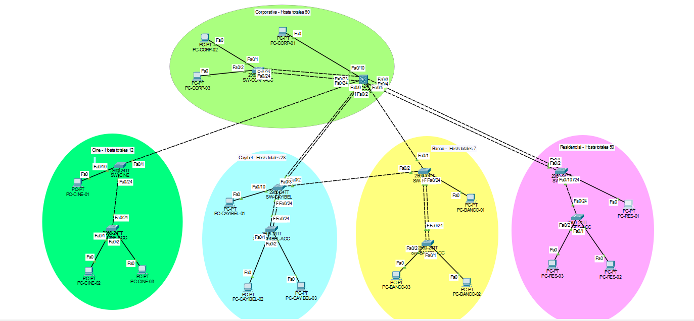

### 4.1. Conexiones entre switches

En todos estos enlaces, la VLAN nativa es **99**.

| Extremo A | Puertos A | Extremo B | Puertos B | Enlace lógico | VLANs permitidas |
|---|---|---|---|---|---|
| SW-CORP | Fa0/1 y Fa0/2 | SW-CAYIBEL | Fa0/1 y Fa0/2 | Po1, PAgP | 25,55,99 |
| SW-CORP | Fa0/3 y Fa0/4 | SW-RES | Fa0/1 y Fa0/2 | Po2, PAgP | 45,99 |
| SW-CORP | Fa0/5 | SW-BANCO | Fa0/1 | Troncal individual | 25,55,99 |
| SW-CAYIBEL | Fa0/3 | SW-BANCO | Fa0/2 | Troncal individual | 25,55,99 |
| SW-CORP | Fa0/6 | SW-CINE | Fa0/1 | Troncal individual | 35,99 |
| SW-CORP | Fa0/23 y Fa0/24 | SW-CORP-ACC | Fa0/23 y Fa0/24 | Po3, PAgP | 15,99 |
| SW-CAYIBEL | Fa0/23 y Fa0/24 | SW-CAYIBEL-ACC | Fa0/23 y Fa0/24 | Po3, PAgP | 25,99 |
| SW-RES | Fa0/24 | SW-RES-ACC | Fa0/24 | Troncal individual | 45,99 |
| SW-CINE | Fa0/24 | SW-CINE-ACC | Fa0/24 | Troncal individual | 35,99 |
| SW-BANCO | Fa0/24 | SW-BANCO-ACC | Fa0/24 | Principal, costo STP 19 | 55,99 |
| SW-BANCO | Fa0/23 | SW-BANCO-ACC | Fa0/23 | Respaldo, costo STP 25 | 55,99 |

El número de Port-channel es local a cada switch. Por ello, Po3 puede utilizarse en distintos pares de switches sin representar un único canal compartido.

### 4.2. Conexiones de las PCs

En cada zona se conserva el mismo patrón:

| PC | Switch de conexión | Puerto del switch |
|---|---|---|
| PC de la zona terminada en `01` | Switch principal de su zona | Fa0/10 |
| PC de la zona terminada en `02` | Switch de acceso de su zona | Fa0/1 |
| PC de la zona terminada en `03` | Switch de acceso de su zona | Fa0/2 |

Cada PC utiliza su interfaz FastEthernet0.

## 5. VLANs

| VLAN | Nombre | Uso |
|---|---|---|
| 15 | CORPORATIVA | Usuarios de la zona corporativa. |
| 25 | CAYIBEL | Usuarios de la zona gastronómica. |
| 35 | CINE | Usuarios del cine. |
| 45 | RESIDENCIAL | Usuarios de la zona residencial. |
| 55 | BANCO | Usuarios de la zona bancaria. |
| 99 | GESTION | Administración de switches y VLAN nativa de las troncales. |
| 999 | BLACKHOLE | Puertos sin uso, configurados como access y apagados. |

Las VLANs de usuarios separan los dominios de broadcast. La comunicación unicast entre VLANs se habilita mediante las SVI de SW-CORP.

Las VLANs predeterminadas del switch no se utilizan como VLANs de usuarios del proyecto.

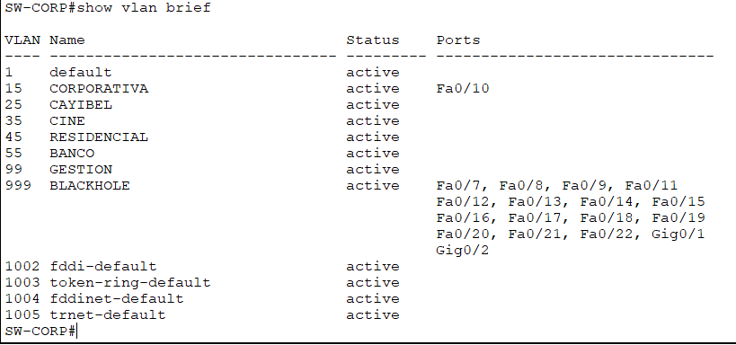

## 6. Direccionamiento VLSM

Se utiliza el bloque **192.168.55.0/24**.

El tamaño de cada subred permite alojar los hosts previstos y su puerta de enlace. La simulación utiliza solamente tres PCs por VLAN de usuarios.

| VLAN | Hosts previstos | Subred | Máscara | Rango utilizable | Broadcast | Gateway |
|---|---:|---|---|---|---|---|
| 15 | 60 | 192.168.55.0/26 | 255.255.255.192 | 192.168.55.1–62 | 192.168.55.63 | 192.168.55.1 |
| 45 | 50 | 192.168.55.64/26 | 255.255.255.192 | 192.168.55.65–126 | 192.168.55.127 | 192.168.55.65 |
| 25 | 28 | 192.168.55.128/27 | 255.255.255.224 | 192.168.55.129–158 | 192.168.55.159 | 192.168.55.129 |
| 35 | 12 | 192.168.55.160/28 | 255.255.255.240 | 192.168.55.161–174 | 192.168.55.175 | 192.168.55.161 |
| 55 | 7 | 192.168.55.176/28 | 255.255.255.240 | 192.168.55.177–190 | 192.168.55.191 | 192.168.55.177 |
| 99 | Gestión de 10 switches | 192.168.55.192/28 | 255.255.255.240 | 192.168.55.193–206 | 192.168.55.207 | 192.168.55.193 |

El intervalo **192.168.55.208–255** queda disponible para futuras asignaciones.

### 6.1. Direcciones de las PCs

| PC | VLAN | Dirección IP | Máscara | Gateway |
|---|---|---|---|---|
| PC-CORP-01 | 15 | 192.168.55.2 | 255.255.255.192 | 192.168.55.1 |
| PC-CORP-02 | 15 | 192.168.55.3 | 255.255.255.192 | 192.168.55.1 |
| PC-CORP-03 | 15 | 192.168.55.4 | 255.255.255.192 | 192.168.55.1 |
| PC-CAYIBEL-01 | 25 | 192.168.55.130 | 255.255.255.224 | 192.168.55.129 |
| PC-CAYIBEL-02 | 25 | 192.168.55.131 | 255.255.255.224 | 192.168.55.129 |
| PC-CAYIBEL-03 | 25 | 192.168.55.132 | 255.255.255.224 | 192.168.55.129 |
| PC-CINE-01 | 35 | 192.168.55.162 | 255.255.255.240 | 192.168.55.161 |
| PC-CINE-02 | 35 | 192.168.55.163 | 255.255.255.240 | 192.168.55.161 |
| PC-CINE-03 | 35 | 192.168.55.164 | 255.255.255.240 | 192.168.55.161 |
| PC-RES-01 | 45 | 192.168.55.66 | 255.255.255.192 | 192.168.55.65 |
| PC-RES-02 | 45 | 192.168.55.67 | 255.255.255.192 | 192.168.55.65 |
| PC-RES-03 | 45 | 192.168.55.68 | 255.255.255.192 | 192.168.55.65 |
| PC-BANCO-01 | 55 | 192.168.55.178 | 255.255.255.240 | 192.168.55.177 |
| PC-BANCO-02 | 55 | 192.168.55.179 | 255.255.255.240 | 192.168.55.177 |
| PC-BANCO-03 | 55 | 192.168.55.180 | 255.255.255.240 | 192.168.55.177 |

Para configurar una PC:

1. Abrir la PC en Packet Tracer.
2. Entrar en **Desktop → IP Configuration**.
3. Seleccionar **Static**.
4. Introducir la IP, máscara y gateway de la tabla.

### 6.2. Direcciones de gestión

Todos los switches utilizan la máscara **255.255.255.240** en VLAN 99.

| Switch | Dirección de gestión |
|---|---|
| SW-CORP | 192.168.55.193 |
| SW-CORP-ACC | 192.168.55.194 |
| SW-CAYIBEL | 192.168.55.195 |
| SW-CAYIBEL-ACC | 192.168.55.196 |
| SW-CINE | 192.168.55.197 |
| SW-CINE-ACC | 192.168.55.198 |
| SW-RES | 192.168.55.199 |
| SW-RES-ACC | 192.168.55.200 |
| SW-BANCO | 192.168.55.201 |
| SW-BANCO-ACC | 192.168.55.202 |

Los switches 2960 utilizan **192.168.55.193** como `ip default-gateway`.

## 7. VTP

Parámetros del dominio:

| Parámetro | Valor |
|---|---|
| Dominio | 202202055 |
| Versión | 2 |
| Contraseña del laboratorio | Cayala2026 |
| Revisión observada en el archivo final | 113 |
| Switches principales | Server |
| Switches de acceso | Client |

| Modo Server | Modo Client |
|---|---|
| SW-CORP | SW-CORP-ACC |
| SW-CAYIBEL | SW-CAYIBEL-ACC |
| SW-CINE | SW-CINE-ACC |
| SW-RES | SW-RES-ACC |
| SW-BANCO | SW-BANCO-ACC |

Las VLANs se crean desde un servidor VTP y se distribuyen por los enlaces troncales. Los clientes reciben la base de VLANs.

Comando de verificación:

```text
show vtp status
```

La revisión 113 corresponde al archivo entregado. Al reconstruir el laboratorio, el número puede ser diferente; deben comprobarse la coincidencia del dominio y la sincronización de la base de VLANs.

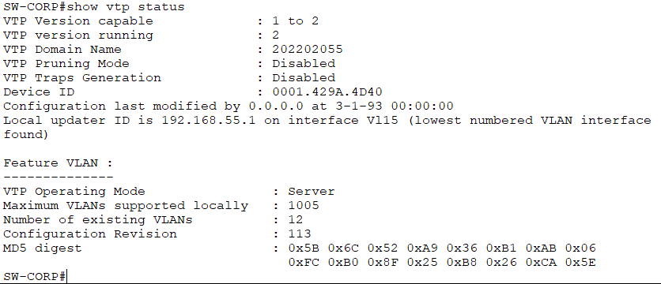

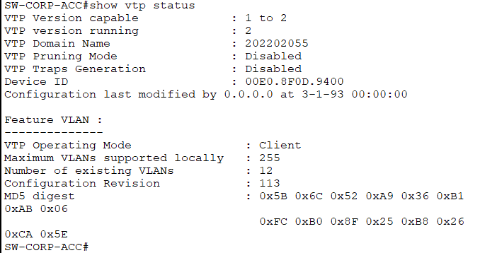

## 8. Rapid PVST y elección de raíces

Todos los switches utilizan:

```text
spanning-tree mode rapid-pvst
```

Cada switch principal tiene prioridad **4096** para la VLAN de usuarios de su zona. SW-CORP también tiene prioridad 4096 para VLAN 99 y prioridad 8192 como alternativa en las demás VLANs de usuarios.

| VLAN | Raíz prevista | Prioridad configurada | Prioridad mostrada con extensión de VLAN |
|---|---|---:|---:|
| 15 | SW-CORP | 4096 | 4111 |
| 25 | SW-CAYIBEL | 4096 | 4121 |
| 35 | SW-CINE | 4096 | 4131 |
| 45 | SW-RES | 4096 | 4141 |
| 55 | SW-BANCO | 4096 | 4151 |
| 99 | SW-CORP | 4096 | 4195 |

La prioridad mostrada incorpora el identificador de VLAN. Por ejemplo, para VLAN 15 se obtiene **4096 + 15 = 4111**.

En SW-CORP, las capturas de VLAN 15 y VLAN 99 muestran `This bridge is the root`.

Comandos de verificación:

```text
show spanning-tree summary
show spanning-tree vlan 15
show spanning-tree vlan 99
```

Los puertos de PCs utilizan PortFast y BPDU Guard. Los enlaces entre switches participan en STP.

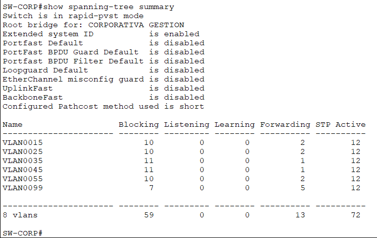

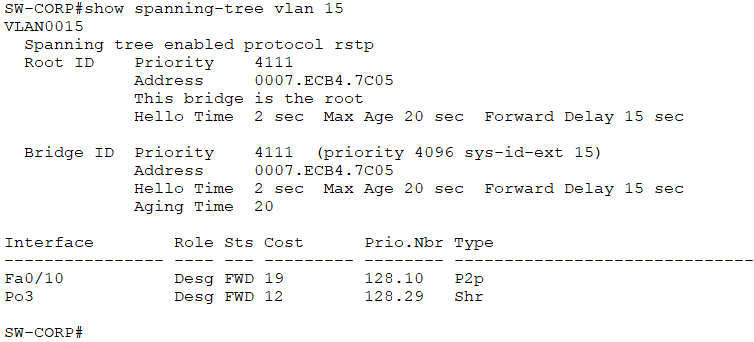

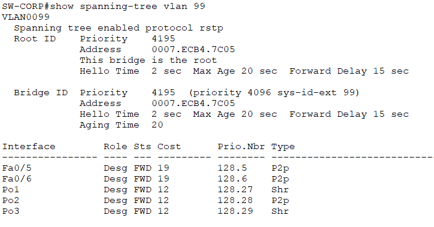

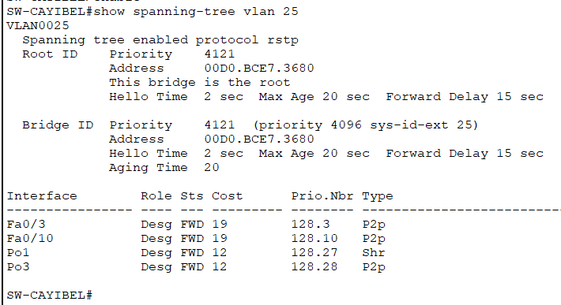

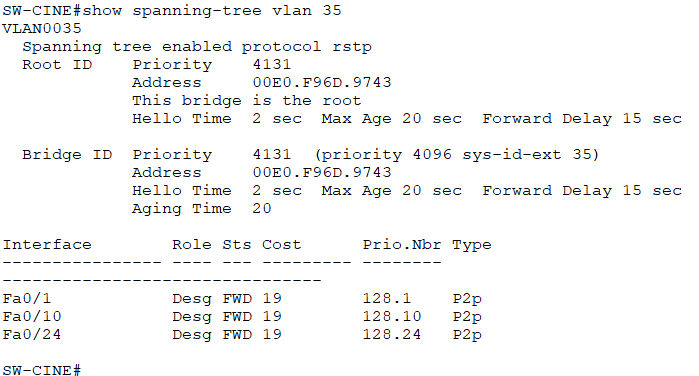

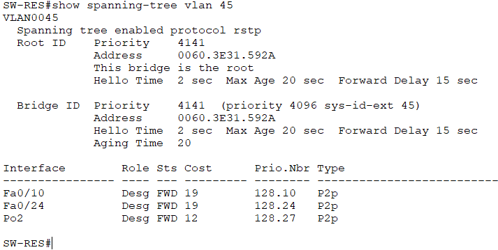

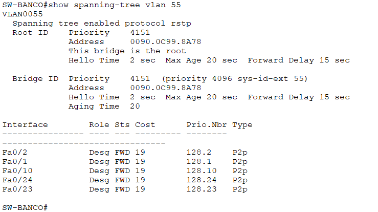

## 9. EtherChannel PAgP

El último dígito del carnet es impar, por lo que se utiliza **PAgP**.

Los miembros se configuran en modo `desirable` en ambos extremos.

Existen cuatro EtherChannels distintos:

| Par de switches | Grupo | Miembros |
|---|---|---|
| SW-CORP ↔ SW-CAYIBEL | Po1 | Dos enlaces físicos. |
| SW-CORP ↔ SW-RES | Po2 | Dos enlaces físicos. |
| SW-CORP ↔ SW-CORP-ACC | Po3 | Dos enlaces físicos. |
| SW-CAYIBEL ↔ SW-CAYIBEL-ACC | Po3 | Dos enlaces físicos. |

Verificación:

```text
show etherchannel summary
```

En SW-CORP se observa:

```text
1  Po1(SU)  PAgP  Fa0/1(P)  Fa0/2(P)
2  Po2(SU)  PAgP  Fa0/3(P)  Fa0/4(P)
3  Po3(SU)  PAgP  Fa0/23(P) Fa0/24(P)
```

Interpretación:

- `S`: Port-channel de capa 2.
- `U`: Port-channel en uso.
- `P`: interfaz física integrada en el canal.

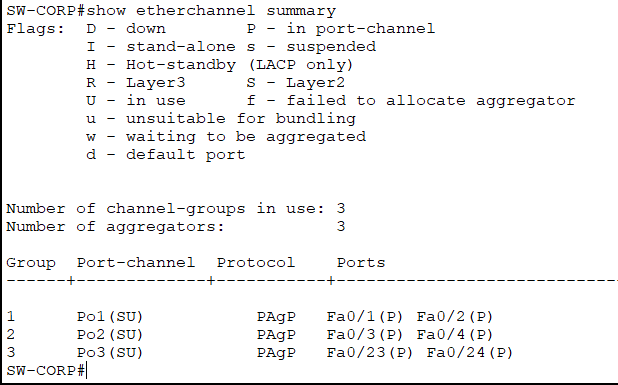

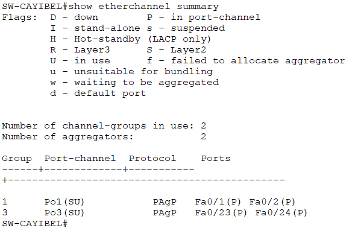

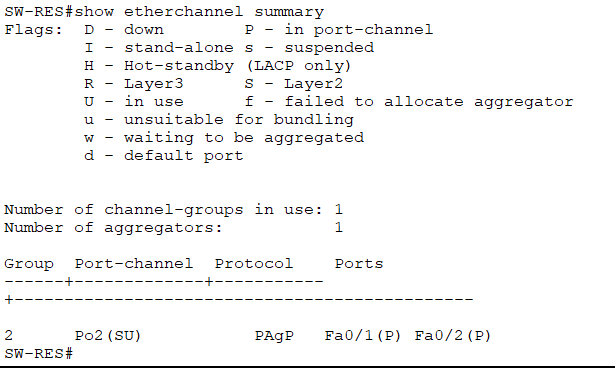

## 10. Troncales y redundancia bancaria

Las troncales utilizan 802.1Q, VLAN nativa 99 y listas explícitas de VLANs permitidas.

Verificación:

```text
show interfaces trunk
```

Las listas permitidas corresponden a la tabla de conexiones del apartado 4.1. Las VLANs que aparecen en la sección de forwarding dependen del estado STP de cada enlace.

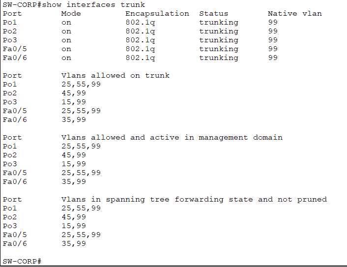

### 10.1. Diseño final del acceso bancario

SW-BANCO y SW-BANCO-ACC se conectan mediante dos troncales independientes:

| Puerto en ambos extremos | Función | Costo STP | VLANs permitidas |
|---|---|---:|---|
| Fa0/24 | Principal | 19 | 55,99 |
| Fa0/23 | Respaldo | 25 | 55,99 |

Estos puertos no pertenecen a Po3 en la configuración final.

En condiciones normales, se espera que SW-BANCO-ACC seleccione Fa0/24 como puerto raíz y mantenga Fa0/23 como alterno para las VLANs 55 y 99.

Un enlace alterno en estado `Altn BLK` es parte del funcionamiento de STP. Debe existir un camino activo en forwarding para la comunicación.

Comandos de comprobación en SW-BANCO-ACC:

```text
show spanning-tree vlan 55
show spanning-tree vlan 99
show interfaces trunk
```

**Alcance de validación:** la prueba de caída del enlace principal Fa0/24 en el área bancaria fue omitida. Se documenta la configuración de redundancia, sin certificar su conmutación mediante esa prueba.

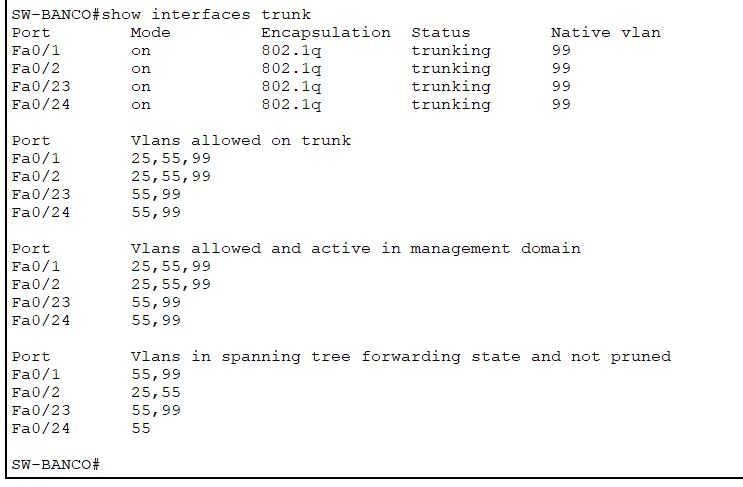

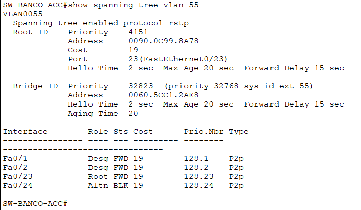

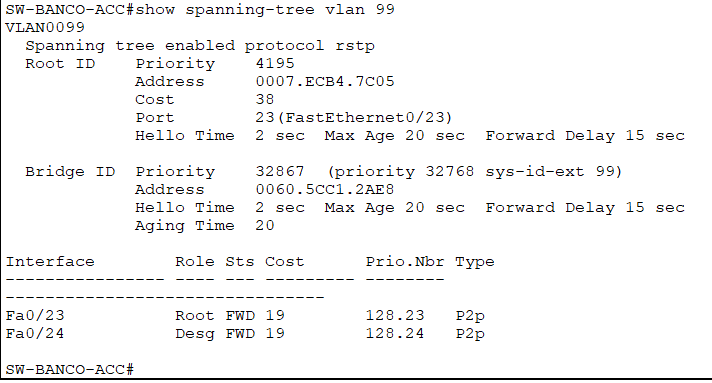

## 11. Puertos sin uso

Todos los puertos físicos sin uso se asignan a VLAN 999, se configuran como access y permanecen apagados.

| Switch | Puertos sin uso |
|---|---|
| SW-CORP | Fa0/7–9, Fa0/11–22, Gi0/1–2 |
| SW-CORP-ACC | Fa0/3–22, Gi0/1–2 |
| SW-CAYIBEL | Fa0/4–9, Fa0/11–22, Gi0/1–2 |
| SW-CAYIBEL-ACC | Fa0/3–22, Gi0/1–2 |
| SW-CINE | Fa0/2–9, Fa0/11–23, Gi0/1–2 |
| SW-CINE-ACC | Fa0/3–23, Gi0/1–2 |
| SW-RES | Fa0/3–9, Fa0/11–23, Gi0/1–2 |
| SW-RES-ACC | Fa0/3–23, Gi0/1–2 |
| SW-BANCO | Fa0/3–9, Fa0/11–22, Gi0/1–2 |
| SW-BANCO-ACC | Fa0/3–22, Gi0/1–2 |

Configuración aplicada a cada grupo correspondiente:

```text
switchport mode access
switchport access vlan 999
shutdown
```

El enlace temporal de pruebas por Fa0/22 en bancos no forma parte de la topología final. Fa0/22 permanece sin uso y apagado en ambos switches bancarios.

Verificación:

```text
show interfaces status
```

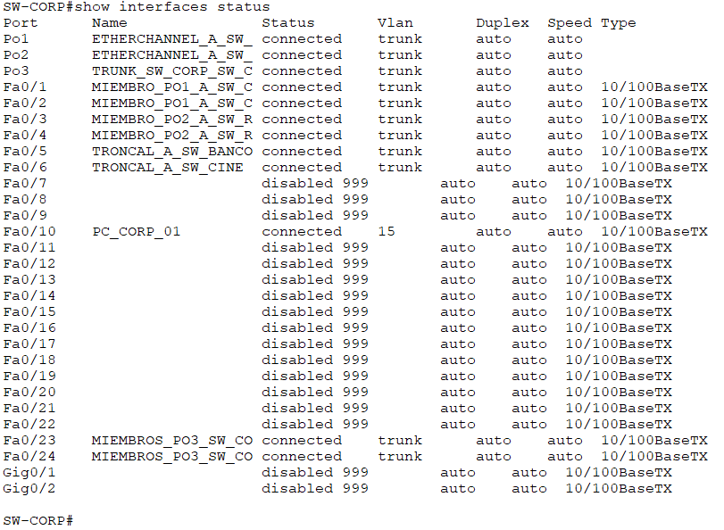

## 12. Enrutamiento entre VLANs

SW-CORP tiene habilitado:

```text
ip routing
```

Las puertas de enlace están configuradas en las SVI de VLANs 15, 25, 35, 45, 55 y 99.

Las seis SVI se observaron en estado **up/up**.

Comandos de verificación:

```text
show ip interface brief
show ip route
```

Redes directamente conectadas:

| Red | Interfaz |
|---|---|
| 192.168.55.0/26 | Vlan15 |
| 192.168.55.64/26 | Vlan45 |
| 192.168.55.128/27 | Vlan25 |
| 192.168.55.160/28 | Vlan35 |
| 192.168.55.176/28 | Vlan55 |
| 192.168.55.192/28 | Vlan99 |

No se requiere una ruta predeterminada para comunicar estas redes directamente conectadas. El laboratorio no incorpora salida a Internet.

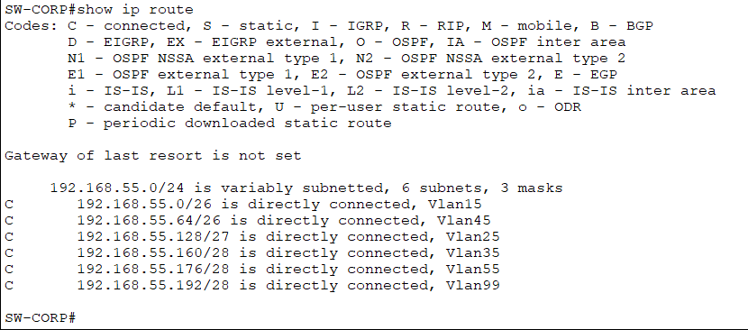

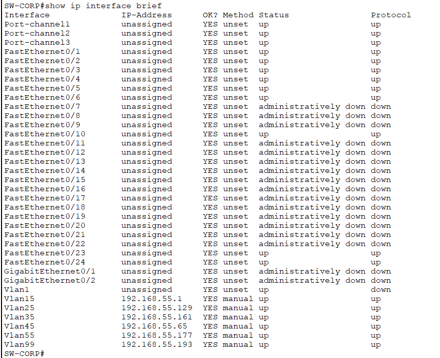

## 13. Dominios de colisión

Para el conteo académico se considera cada enlace Ethernet físico como un segmento de colisión separado.

| Categoría | Enlaces físicos |
|---|---:|
| Entre switches principales | 7 |
| Entre switches principales y de acceso | 8 |
| Entre switches y PCs | 15 |
| **Total** | **30** |

Los dos extremos de un mismo cable pertenecen al mismo segmento y no se cuentan dos veces.

EtherChannel agrupa enlaces de forma lógica, pero cada miembro sigue siendo un enlace físico. Un enlace bloqueado por STP tampoco desaparece del conteo físico.

En operación full-duplex no ocurren colisiones Ethernet. El total anterior corresponde a la separación de segmentos solicitada para la práctica.

El dispositivo de alimentación de Packet Tracer no aporta enlaces Ethernet a este conteo.

## 14. Pruebas de conectividad

Las pruebas se ejecutan desde **Desktop → Command Prompt** de las PCs.

### 14.1. Diez pruebas dentro de las VLANs

Para documentar la comunicación local, utilizar esta matriz y guardar las cinco capturas indicadas:

| PC de origen | Primer destino | Segundo destino |
|---|---|---|
| PC-CORP-01 | 192.168.55.3 | 192.168.55.4 |
| PC-CAYIBEL-01 | 192.168.55.131 | 192.168.55.132 |
| PC-CINE-01 | 192.168.55.163 | 192.168.55.164 |
| PC-RES-01 | 192.168.55.67 | 192.168.55.68 |
| PC-BANCO-01 | 192.168.55.179 | 192.168.55.180 |

Cada fila contiene dos pings, para un total de diez pruebas.

El resultado esperado después de resolver ARP es recibir respuestas de los destinos.

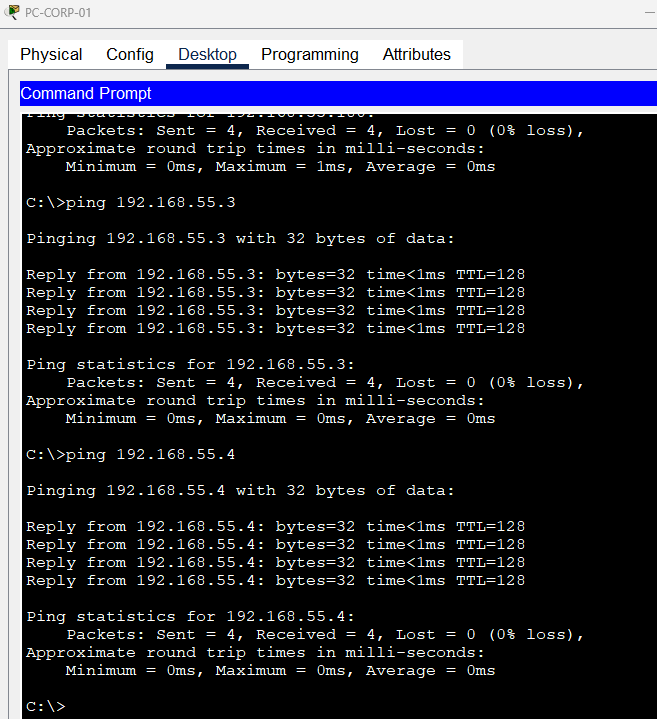

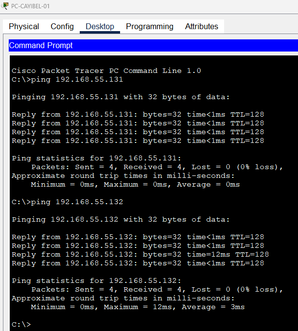

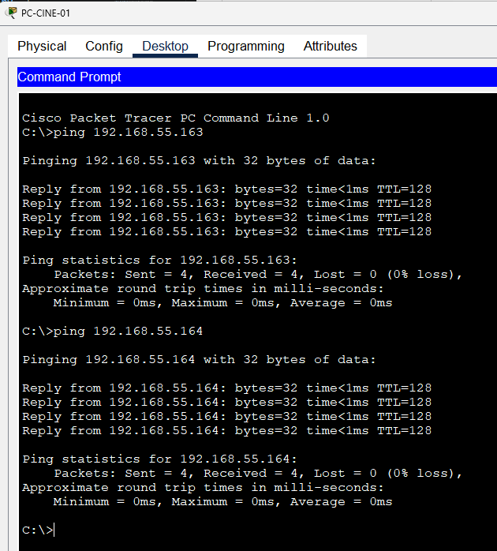

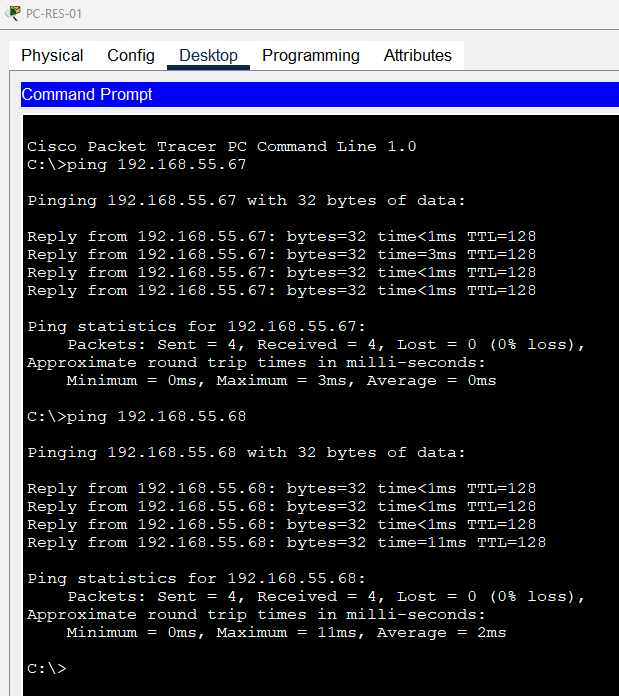

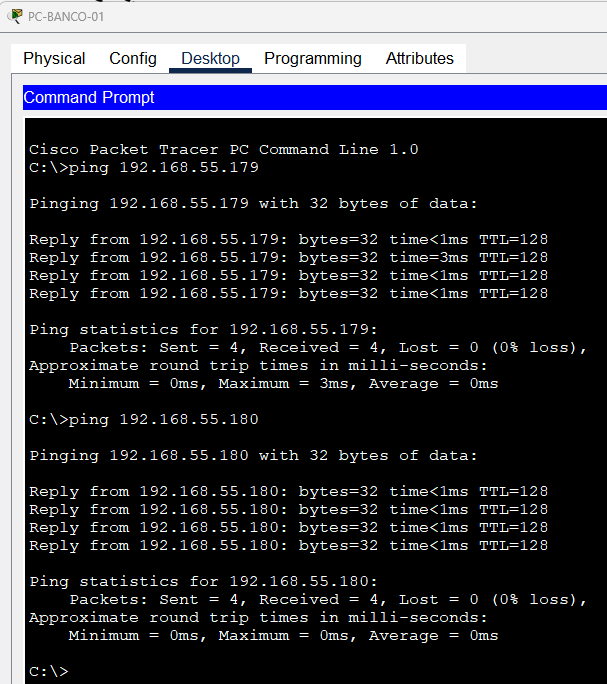

### 14.2. Comunicación entre las zonas

En la validación final se confirmó respuesta desde PC-CORP-01 hacia las otras catorce PCs:

- Corporativa: 192.168.55.3 y 192.168.55.4.
- Cayibel: 192.168.55.130, 192.168.55.131 y 192.168.55.132.
- Cine: 192.168.55.162, 192.168.55.163 y 192.168.55.164.
- Residencial: 192.168.55.66, 192.168.55.67 y 192.168.55.68.
- Banco: 192.168.55.178, 192.168.55.179 y 192.168.55.180.

También se confirmó respuesta desde PC-CORP-02 y PC-CORP-03 hacia PC-BANCO-03, dirección 192.168.55.180.

Estas pruebas comprueban la comunicación normal entre zonas mediante SW-CORP. No constituyen una validación de conmutación durante fallas.

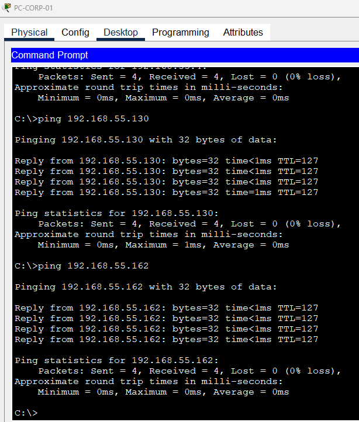

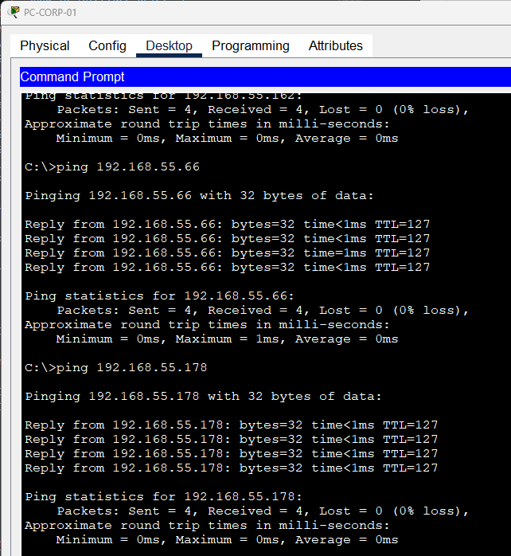

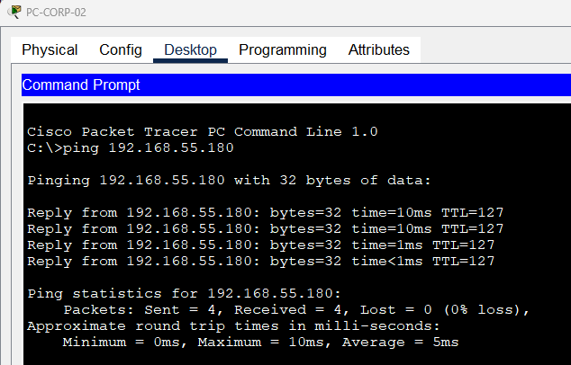

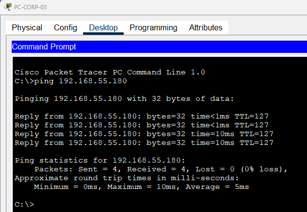

### 14.3. Interpretación del aislamiento

Las VLANs separan el tráfico de broadcast de las zonas.

El enrutamiento mediante SVI permite comunicar direcciones de distintas VLANs. Por ello, un ping exitoso entre zonas es compatible con la segmentación implementada.

No se implementan ACL de restricción entre zonas en este laboratorio.

## 15. Configuración y almacenamiento

La configuración CLI para reconstruir el laboratorio se encuentra en:

[Configuracion_CLI.md](Configuracion_CLI.md)

La configuración de cada switch se guarda mediante:

```text
copy running-config startup-config
```

En el archivo final revisado, running-config y startup-config coinciden en los diez switches.

Después de guardar las configuraciones, el proyecto se conserva como:

```text
Cayala_202202055_Final.pkt
```


## 16. Referencias

### Establecimientos y zonas

- Cayalá. [Regus](https://cayala.com/directorio/regus).
- Cayalá. [Cayibel](https://cayala.com/cayibel).
- Cayalá. [Cinépolis](https://cayala.com/directorio/cinepolis).
- Cayalá. [Nogales de Cayalá](https://cayala.com/proyectos/nogales).
- Cayalá. [Banco Industrial](https://cayala.com/directorio/banco-industrial).

### Documentación técnica

- Cisco. [Configuración de EtherChannel en Catalyst 2960](https://www.cisco.com/c/en/us/td/docs/switches/lan/catalyst2960/software/release/15-0_2_se/configuration/guide/scg2960/swethchl.html).
- Cisco. [Configuración de Spanning Tree en Catalyst 2960](https://www.cisco.com/c/en/us/td/docs/switches/lan/catalyst2960/software/release/15-0_2_ez/configuration/guide/scg_2960/swstp.html).
- Cisco. [Funciones opcionales de Spanning Tree](https://www.cisco.com/c/en/us/td/docs/switches/lan/catalyst2960/software/release/15-0_2_se/configuration/guide/scg2960/swstpopt.html).