# BanTech GT — Infraestructura de Red Nacional

**Universidad:** Universidad de San Carlos de Guatemala  
**Curso:** Redes de Computadoras 1  
**Proyecto:** Proyecto 2 — Segundo Semestre 2026  
**Empresa simulada:** BanTech GT  
**Grupo:** 9  
**Carnet del coordinador:** 202202055  
**Herramienta:** Cisco Packet Tracer 8.2.2  
**integrante 1:** 202300652	- Vasti Abigail González Pereira  
**integrante 2:** 202300484	- Diana Myriam Prisicla Santizo Cáceres
**integrante 3:** 202202055	- Fernando Andhré González Espinoza 

---

## 1. Introducción

El presente proyecto consiste en el diseño, implementación y validación de una infraestructura de red nacional para el corporativo financiero ficticio **BanTech GT**, una institución que necesita garantizar la continuidad de sus operaciones bancarias mediante una arquitectura escalable, segmentada y tolerante a fallos.

La infraestructura interconecta cuatro sedes: Occidente, Norte, Oriente y Data Center Central, mediante un Backbone Nacional redundante que permite intercambiar información entre diferentes dominios de enrutamiento.

Para su implementación se utilizaron tecnologías Cisco como OSPF, EIGRP, RIPv2, rutas estáticas, VLANs, VTP, Router-on-a-Stick, interfaces SVI, Rapid PVST+, EtherChannel y HSRP.

El diseño fue desarrollado en Cisco Packet Tracer, realizando pruebas de conectividad, propagación de rutas, comunicación inter-VLAN y recuperación ante fallos.

## 2. Objetivos

### 2.1. Objetivo general

Diseñar e implementar una infraestructura de red multisede para BanTech GT, garantizando conectividad nacional, segmentación lógica, integración de protocolos de enrutamiento y mecanismos de alta disponibilidad.

### 2.2. Objetivos específicos

- Implementar un Backbone Nacional redundante que interconecte las cuatro sedes.
- Configurar OSPF, EIGRP, RIPv2 y rutas estáticas.
- Redistribuir rutas entre los diferentes dominios.
- Segmentar las áreas funcionales mediante VLANs.
- Aplicar subneteo VLSM según los requerimientos de hosts.
- Implementar EtherChannel para agregación y redundancia de enlaces.
- Configurar Rapid PVST+ y definir manualmente los Root Bridges.
- Implementar HSRP para proporcionar gateways redundantes.
- Verificar la comunicación entre VLANs y entre sedes.
- Realizar pruebas de recuperación ante fallos.

## 3. Descripción general de la arquitectura

**Topología General de la Red**
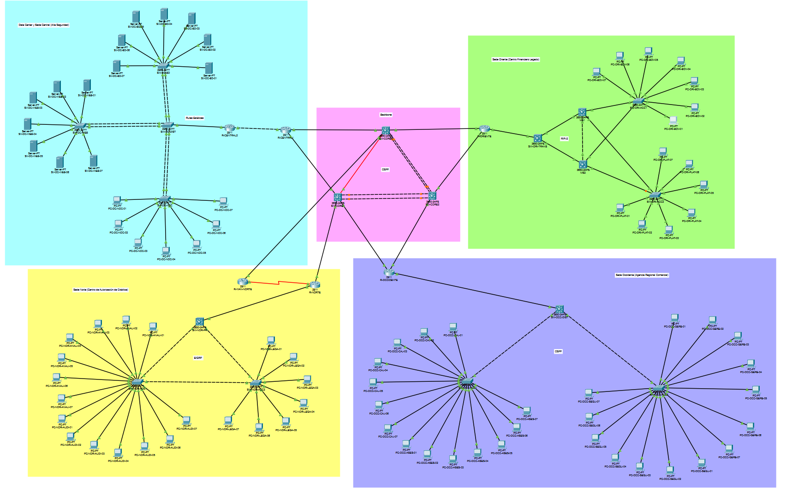


La red se divide en dos componentes principales:

**Backbone Nacional:** núcleo encargado de interconectar las sedes mediante enlaces redundantes, protocolos de enrutamiento y redistribución de rutas.

**Redes de borde:** infraestructura interna de cada sede, diseñada según sus necesidades particulares de disponibilidad, seguridad, segmentación y rendimiento.

| Sede | Protocolo principal | Tecnología destacada |
|---|---|---|
| Occidente | OSPF | Router-on-a-Stick y VTP |
| Norte | EIGRP AS 55 | SVI y Rapid PVST+ |
| Oriente | RIPv2 | HSRP y gateways redundantes |
| Central | Rutas estáticas | EtherChannel y Router-on-a-Stick |
| Backbone | OSPF área 0 | Redundancia y agregación LACP |

### 3.1. Topología del Backbone Nacional

El núcleo está compuesto por tres switches multicapa Cisco Catalyst 3650-24PS: SW-CORE1, SW-CORE2 y SW-CORE3.

Estos equipos forman una topología triangular que permite disponer de caminos alternativos para transportar el tráfico de las sedes.

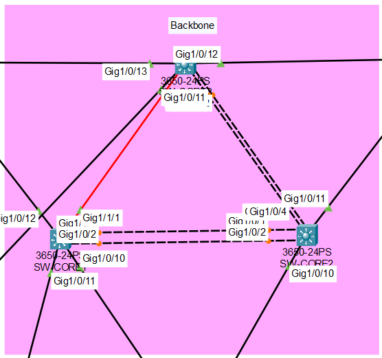

**Justificación técnica:** se seleccionó una topología triangular para proporcionar caminos físicos alternativos. EtherChannel permite agrupar enlaces físicos y OSPF calcula rutas disponibles ante cambios de conectividad. La combinación mejora la disponibilidad del núcleo y reduce la dependencia de un único enlace.

## 4. Backbone Nacional

### 4.1. Dispositivos principales

| Dispositivo | Modelo | Función |
|---|---|---|
| SW-CORE1 | Cisco 3650-24PS | Switch multicapa principal |
| SW-CORE2 | Cisco 3650-24PS | Switch multicapa secundario |
| SW-CORE3 | Cisco 3650-24PS | Tercer nodo del núcleo |
| R-OCCIDENTE | Cisco 2911 | Router de borde Occidente |
| R-NORTE | Cisco 2911 | Router de borde Norte |
| R-WAN-NORTE | Cisco 2911 | Conectividad WAN redundante |
| R-ORIENTE | Cisco 2911 | Router de borde Oriente |
| R-CENTRAL1 | Cisco 2911 | Redistribución de rutas estáticas |

### 4.2. Conexiones del núcleo

| Origen | Destino | Tecnología |
|---|---|---|
| SW-CORE1 | SW-CORE2 | EtherChannel Po1 — LACP |
| SW-CORE2 | SW-CORE3 | EtherChannel Po2 — LACP |
| SW-CORE1 | SW-CORE3 | Fibra óptica |
| R-NORTE | R-WAN-NORTE | Enlace serial WAN |
| Switches CORE | Routers de borde | Ethernet |

Los enlaces punto a punto utilizan subredes con máscara `/30`, permitiendo asignar dos direcciones utilizables por conexión.

### 4.3. Direccionamiento de los enlaces principales

| Conexión | Subred | Extremos |
|---|---|---|
| CORE1 ↔ CORE2 | `10.55.250.0/30` | `.1` y `.2` |
| CORE2 ↔ CORE3 | `10.55.250.4/30` | `.5` y `.6` |
| CORE1 ↔ CORE3 | `10.55.250.8/30` | `.9` y `.10` |
| CORE1 ↔ R-OCCIDENTE | `10.55.250.12/30` | `.13` y `.14` |
| CORE2 ↔ R-OCCIDENTE | `10.55.250.16/30` | `.17` y `.18` |
| CORE1 ↔ R-NORTE | `10.55.250.20/30` | `.21` y `.22` |
| CORE3 ↔ R-WAN-NORTE | `10.55.250.24/30` | `.25` y `.26` |
| R-WAN-NORTE ↔ R-NORTE | `10.55.250.28/30` | `.29` y `.30` |
| CORE2 ↔ R-ORIENTE | `10.55.250.32/30` | `.33` y `.34` |
| CORE3 ↔ R-ORIENTE | `10.55.250.36/30` | `.37` y `.38` |
| CORE1 ↔ R-CENTRAL1 | `10.55.250.40/30` | `.41` y `.42` |
| CORE3 ↔ R-CENTRAL1 | `10.55.250.44/30` | `.45` y `.46` |

### 4.4. EtherChannel

Se implementaron 3 grupos EtherChannel con LACP:

| Grupo | Switches | Interfaces |
|---|---|---|
| Po1 | CORE1 ↔ CORE2 | Gi1/0/1 y Gi1/0/2 de ambos |
| Po2 | CORE2 ↔ CORE3 | Gi1/0/3–4 en CORE2 y Gi1/0/1–2 en CORE3 |

La agregación permite mantener un enlace lógico operativo cuando uno de sus miembros físicos falla, siempre que permanezca otro miembro disponible.

**Comando de verificación en SW-CORE2:**

```cisco
show etherchannel summary
```

Resultado comprobado: `Po1(RU)` y `Po2(RU)` con sus miembros en estado `(P)`.

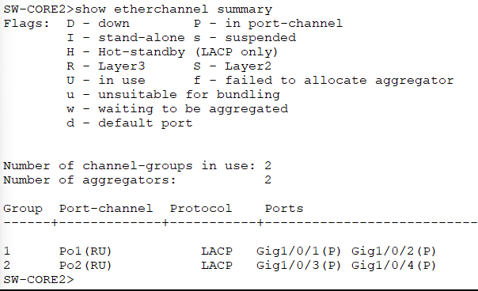

### 4.5. Enrutamiento OSPF

El Backbone Nacional utiliza OSPF proceso 1, área 0.

Los tres switches multicapa mantienen relaciones de vecindad para intercambiar rutas y calcular los caminos disponibles hacia las sedes.

**Comandos de verificación:**

Dispositivos: SW-CORE1, SW-CORE2 y SW-CORE3.

```cisco
show ip ospf neighbor
show ip route ospf
```

Se verificaron vecindades en estado FULL y rutas aprendidas hacia las redes de las diferentes sedes.

### 4.6. Redistribución de rutas

Para comunicar los distintos dominios se implementaron puntos de redistribución.

| Dispositivo | Protocolos integrados | Función |
|---|---|---|
| R-NORTE | EIGRP → OSPF | Anunciar las redes del Centro de Créditos |
| R-ORIENTE | RIPv2 → OSPF | Integrar la red legada al núcleo |
| R-CENTRAL1 | Estáticas → OSPF | Publicar las redes del Data Center |

Estas redistribuciones permiten que el Backbone Nacional conozca las redes internas de las sedes, aunque utilicen protocolos diferentes.

**Verificación desde SW-CORE1:**

```cisco
show ip route ospf
```

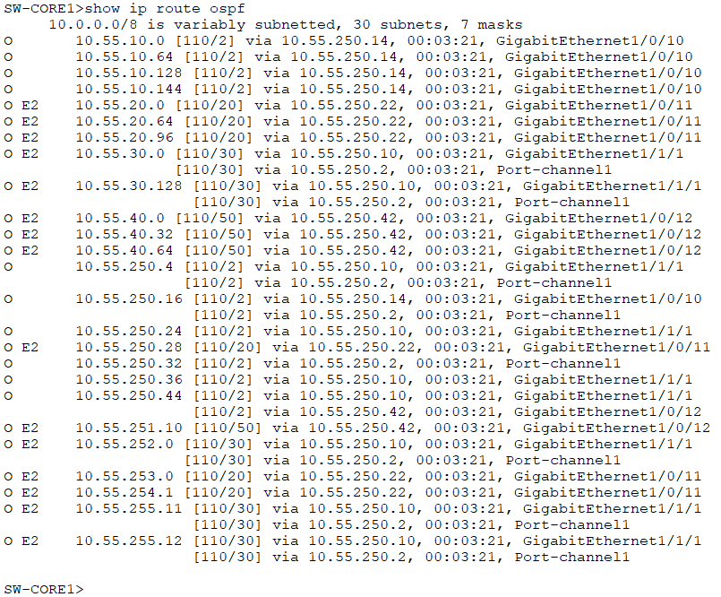

### 4.7. Tolerancia a fallos

Se realizó una prueba controlada deshabilitando los miembros de Po1 entre SW-CORE1 y SW-CORE2.

Durante la falla, OSPF mantuvo comunicación con el resto del núcleo mediante el enlace de fibra óptica hacia SW-CORE3.

La tabla de enrutamiento mostró el camino alternativo y se comprobó conectividad mediante ping. Posteriormente se restauraron los enlaces originales.

**Justificación:** la combinación de enlaces alternativos y OSPF permite que el núcleo continúe operando cuando se interrumpe una de sus conexiones principales.

---

## 5. Plan de direccionamiento IP y VLANs

### 5.1. Reglas de identificación

De acuerdo con las reglas del proyecto:

- Carnet del coordinador: `202202055`
- XX = `55`
- Número de grupo = `9`
- Y = `9`

Estos valores se utilizaron para definir las direcciones IP y los identificadores de las VLANs.

### 5.2. Tabla general de VLANs y subneteo VLSM

| Sede | VLAN | Nombre | Hosts requeridos | Subred | Gateway |
|---|---|---|---:|---|---|
| Occidente | 19 | CAJAS | 45 | `10.55.10.0/26` | `10.55.10.1` |
| Occidente | 29 | ASESORES | 30 | `10.55.10.64/27` | `10.55.10.65` |
| Occidente | 39 | GERENCIA | 10 | `10.55.10.96/28` | `10.55.10.97` |
| Occidente | 49 | SEGURIDAD | 12 | `10.55.10.112/28` | `10.55.10.113` |
| Norte | 59 | ANALISIS | 50 | `10.55.20.0/26` | `10.55.20.1` |
| Norte | 69 | AUDITORIA | 25 | `10.55.20.64/27` | `10.55.20.65` |
| Norte | 79 | LEGAL | 14 | `10.55.20.96/28` | `10.55.20.97` |
| Oriente | 89 | BOVEDA | 40 | `10.55.30.0/26` | `10.55.30.1` |
| Oriente | 99 | PLATAFORMA | 60 | `10.55.30.64/25` | `10.55.30.65` |
| Central | 20 | CORE_BD | 14 | `10.55.40.32/28` | `10.55.40.33` |
| Central | 30 | WEB_APPS | 28 | `10.55.40.0/27` | `10.55.40.1` |
| Central | 40 | NOC | 10 | `10.55.40.48/28` | `10.55.40.49` |

Las máscaras permiten disponer de suficientes direcciones IP para los equipos finales y las puertas de enlace de cada departamento.

### 5.3. Máscaras utilizadas

| Prefijo | Máscara decimal | Hosts utilizables |
|---|---|---:|
| /26 | 255.255.255.192 | 195 |
| /27 | 255.255.255.224 | 83 |
| /28 | 255.255.255.240 | 60 |


El direccionamiento se diseñó mediante VLSM, asignando tamaños diferentes según los requerimientos de cada red.

### 5.4. Direcciones asignadas a los equipos de prueba

| Sede | Dispositivo | IP | Gateway |
|---|---|---|---|
| Occidente | PC-OCC-CAJ-01 | `10.55.10.2/26` | `10.55.10.1` |
| Norte | PC-NOR-ANAL-01 | `10.55.20.2/26` | `10.55.20.1` |
| Oriente | PC-ORI-BOV-01 | `10.55.30.4/26` | `10.55.30.1` |
| Oriente | PC-ORI-PLAT-01 | `10.55.30.68/26` | `10.55.30.65` |
| Central | SV-DC-BD-01 | `10.55.40.34/28` | `10.55.40.33` |
| Central | SV-DC-WEB-01 | `10.55.40.2/27` | `10.55.40.1` |
| Central | PC-DC-NOC-01 | `10.55.40.50/28` | `10.55.40.49` |

Los demás equipos finales reciben direcciones consecutivas disponibles dentro de su respectiva subred, evitando utilizar las direcciones de red, broadcast y gateway.

---

## 6. Sede Occidente — Agencia Regional Comercial

### 6.1. Descripción y diseño

La Sede Occidente concentra operaciones de cajas, asesores, gerencia y seguridad.

Se implementó una arquitectura jerárquica compuesta por un router Cisco 2911, un switch de distribución Cisco 3650-24PS y dos switches de acceso Cisco 2960-24TT.

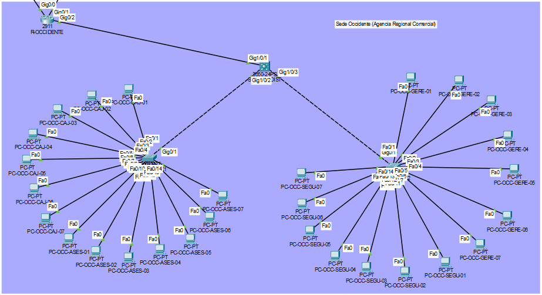

### 6.2. Justificación técnica

Se seleccionó una topología de distribución y acceso para centralizar la administración y separar las operaciones comerciales por VLAN. Router-on-a-Stick permite que R-OCCIDENTE realice el enrutamiento inter-VLAN mediante una sola interfaz física con subinterfaces 802.1Q. VTP facilita la administración y propagación de las definiciones de VLANs a los switches de acceso.

La segmentación reduce el alcance de los broadcasts y organiza las áreas según su función. El router dispone de dos conexiones al Backbone Nacional para mantener caminos alternativos hacia el núcleo.

Cada switch de acceso tiene un uplink hacia distribución, por lo que esta parte del diseño no proporciona redundancia física de uplink en la capa de acceso.

### 6.3. Mapeo de conexiones

| Origen | Puerto | Destino | Puerto |
|---|---|---|---|
| R-OCCIDENTE | Gi0/2 | SW-OCC-DIST | Gi1/0/1 |
| SW-OCC-DIST | Gi1/0/2 | SW-OCC-ACC1 | Gi0/1 |
| SW-OCC-DIST | Gi1/0/3 | SW-OCC-ACC2 | Gi0/1 |

En SW-OCC-ACC1, Fa0/1–7 corresponden a CAJAS y Fa0/8–14 a ASESORES.

En SW-OCC-ACC2, Fa0/1–7 corresponden a GERENCIA y Fa0/8–14 a SEGURIDAD.

### 6.4. Configuración representativa de Router-on-a-Stick

**Dispositivo: R-OCCIDENTE**

```cisco
interface GigabitEthernet0/2.19
 encapsulation dot1Q 19
 ip address 10.55.10.1 255.255.255.192

interface GigabitEthernet0/2.29
 encapsulation dot1Q 29
 ip address 10.55.10.65 255.255.255.224

interface GigabitEthernet0/2.39
 encapsulation dot1Q 39
 ip address 10.55.10.97 255.255.255.240

interface GigabitEthernet0/2.49
 encapsulation dot1Q 49
 ip address 10.55.10.113 255.255.255.240
```

### 6.5. Configuración VTP

**Dispositivo: SW-OCC-DIST**

```cisco
vtp domain bantech55
vtp password cisco
vtp version 2
vtp mode server
```
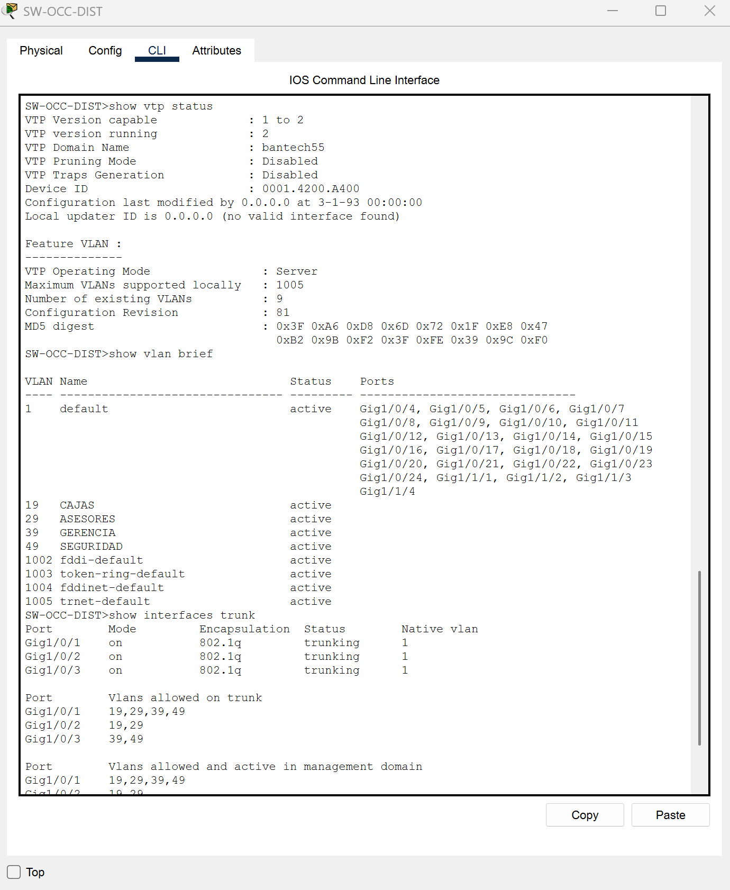

**Dispositivos: SW-OCC-ACC1 y SW-OCC-ACC2**

```cisco
vtp domain bantech55
vtp password cisco
vtp version 2
vtp mode client
```
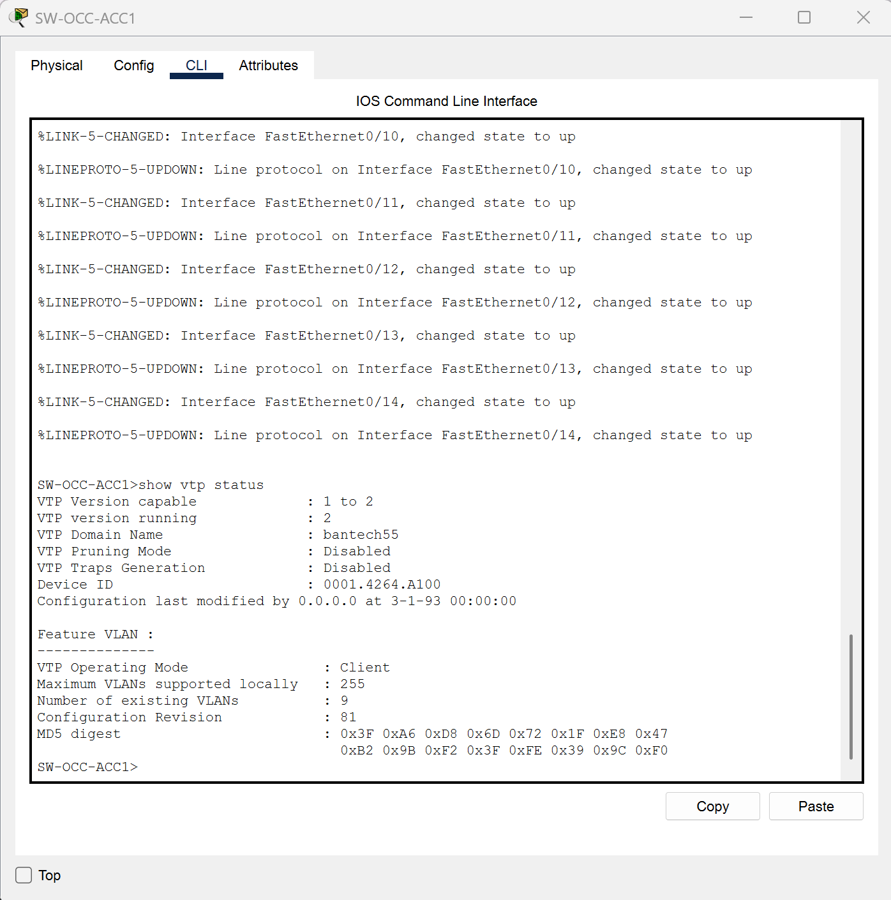

Se verificó que ambos clientes recibieran las cuatro definiciones de VLANs.


**Comandos utilizados:**

```cisco
show vtp status
show vlan brief
show interfaces trunk
```

### 6.6. Resultados de las pruebas

Se comprobaron exitosamente los gateways de las cuatro VLANs y la comunicación entre Cajas, Asesores, Gerencia y Seguridad.

También se verificó la comunicación desde Occidente hacia Norte, Oriente y Central mediante el Backbone Nacional.

---

## 7. Sede Norte — Centro de Autorización de Créditos

### 7.1. Descripción y diseño

La Sede Norte incluye las áreas de Análisis, Auditoría y Legal.

Su diseño utiliza un switch multicapa Cisco 3650-24PS y dos switches de acceso Cisco 2960-24TT interconectados mediante una topología triangular.

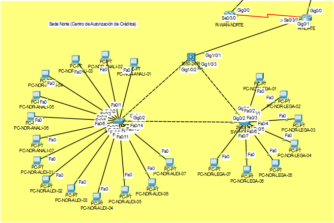

### 7.2. Justificación técnica

Se implementó una topología triangular para disponer de caminos físicos alternativos entre los switches de acceso y el switch principal.

Rapid PVST+ permite mantener una conexión redundante sin producir bucles de capa 2. SW-NOR-PR se estableció manualmente como Root Bridge, mientras que SW-NOR-ACC1 y SW-NOR-ACC2 actúan como switches de acceso.

Las interfaces SVI del switch principal permiten el enrutamiento inter-VLAN, evitando depender de un enlace Router-on-a-Stick para comunicar los departamentos.

El protocolo EIGRP AS 55 permite intercambiar las rutas de Norte con R-NORTE, desde donde se redistribuyen hacia OSPF.

### 7.3. Conexiones

| Origen | Puerto | Destino | Puerto |
|---|---|---|---|
| R-NORTE | Gi0/1 | SW-NOR-PR | Gi1/0/1 |
| SW-NOR-PR | Gi1/0/2 | SW-NOR-ACC1 | Gi0/1 |
| SW-NOR-PR | Gi1/0/3 | SW-NOR-ACC2 | Gi0/1 |
| SW-NOR-ACC1 | Gi0/2 | SW-NOR-ACC2 | Gi0/2 |

### 7.4. Interfaces SVI

**Dispositivo: SW-NOR-PR**

```cisco
ip routing

interface Vlan59
 ip address 10.55.20.1 255.255.255.192
 no shutdown

interface Vlan69
 ip address 10.55.20.65 255.255.255.224
 no shutdown

interface Vlan79
 ip address 10.55.20.97 255.255.255.240
 no shutdown
```

### 7.5. Rapid PVST+

**Dispositivo: SW-NOR-PR**

```cisco
spanning-tree mode rapid-pvst
spanning-tree vlan 59,69,79 priority 4096
```

Se estableció una jerarquía de prioridades:

| Switch | Prioridad configurada |
|---|---:|
| SW-NOR-PR | 4096 |
| SW-NOR-ACC1 | 8192 |
| SW-NOR-ACC2 | 12288 |

### 7.6. Integración EIGRP

El switch SW-NOR-PR mantiene una vecindad EIGRP AS 55 con R-NORTE a través de la red `10.55.253.0/30`.

**Dispositivo: R-NORTE**

```cisco
show ip eigrp neighbors
show ip route eigrp
```

Se comprobaron las rutas hacia:

- `10.55.20.0/26`
- `10.55.20.64/27`
- `10.55.20.96/28`

Estas redes también se observaron desde el Backbone Nacional como rutas OSPF externas.

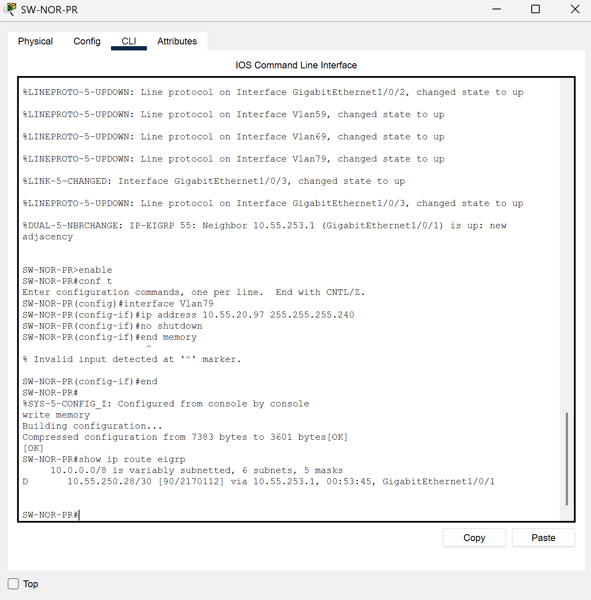

### 7.7. Pruebas de redundancia

Se configuró SW-NOR-PR como Root Bridge de las tres VLANs.

En funcionamiento normal, SW-NOR-ACC2 mantiene Gi0/2 como puerto alternativo bloqueado.

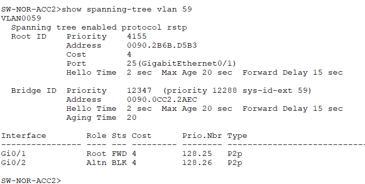

Se realizó una prueba apagando temporalmente Gi1/0/2 de SW-NOR-PR.

Durante la falla, Rapid PVST+ permitió utilizar el enlace entre los switches de acceso como camino alternativo, manteniendo la comunicación después de la convergencia.

**Comando de prueba en SW-NOR-PR:**

```cisco
interface GigabitEthernet1/0/2
 shutdown
```

Posteriormente se restauró mediante `no shutdown`.


**Resultado:** se comprobó la recuperación de conectividad mediante el camino alternativo, sin necesidad de modificar manualmente los gateways de las computadoras.

---

## 8. Sede Oriente — Centro Financiero Legado

### 8.1. Descripción y diseño

Oriente cuenta con las áreas de Bóveda y Plataforma.

Se implementaron dos switches multicapa Cisco 3650-24PS, identificados como MS1 y MS2, junto con dos switches Cisco 2960-24TT de acceso.

Ambos switches de acceso tienen conexiones hacia MS1 y MS2.

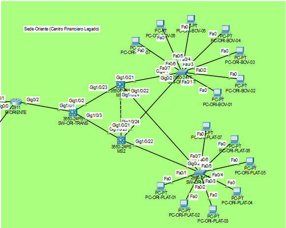

### 8.2. Justificación técnica

Debido a la importancia de las operaciones financieras, se implementó HSRP para proporcionar gateways virtuales redundantes.

MS1 funciona normalmente como gateway activo, mientras MS2 permanece como respaldo.

Los switches de acceso están conectados simultáneamente a ambos dispositivos de distribución, por lo que pueden recuperar comunicación si falla el switch principal.

Rapid PVST+ evita bucles en los enlaces redundantes y RIPv2 permite integrar las redes de Oriente con R-ORIENTE, conservando el dominio de enrutamiento legado.

### 8.3. Conexiones principales

| Origen | Puerto | Destino | Puerto |
|---|---|---|---|
| MS1 | Gi1/0/21 | SW-ORI-ACC1 | Gi0/1 |
| MS2 | Gi1/0/21 | SW-ORI-ACC1 | Gi0/2 |
| MS1 | Gi1/0/22 | SW-ORI-ACC2 | Gi0/1 |
| MS2 | Gi1/0/22 | SW-ORI-ACC2 | Gi0/2 |
| MS1 | Gi1/0/24 | MS2 | Gi1/0/24 |
| SW-ORI-TRANS | Gi1/0/2 | MS1 | Gi1/0/23 |
| SW-ORI-TRANS | Gi1/0/3 | MS2 | Gi1/0/23 |

### 8.4. Direccionamiento HSRP

| Parámetro | VLAN 89 | VLAN 99 |
|---|---|---|
| IP virtual | `10.55.30.1` | `10.55.30.65` |
| IP real MS1 | `10.55.30.2` | `10.55.30.66` |
| IP real MS2 | `10.55.30.3` | `10.55.30.67` |
| Grupo HSRP | 89 | 99 |

### 8.5. Configuración de HSRP

**Dispositivo: MS1**

```cisco
interface Vlan89
 ip address 10.55.30.2 255.255.255.192
 standby 89 ip 10.55.30.1
 standby 89 priority 110
 standby 89 preempt
 exit

interface Vlan99
 ip address 10.55.30.66 255.255.255.192
 standby 99 ip 10.55.30.65
 standby 99 priority 110
 standby 99 preempt
 exit
```

**Dispositivo: MS2**

```cisco
interface Vlan89
 ip address 10.55.30.3 255.255.255.192
 standby 89 ip 10.55.30.1
 standby 89 priority 100
 standby 89 preempt
 exit

interface Vlan99
 ip address 10.55.30.67 255.255.255.192
 standby 99 ip 10.55.30.65
 standby 99 priority 100
 standby 99 preempt
 exit
```

### 8.6. Verificación

**Comando ejecutado en MS1 y MS2:**

```cisco
show standby brief
```

Los resultados mostraron:

| Estado normal | MS1 | MS2 |
|---|---|---|
| VLAN 89 | Active | Standby |
| VLAN 99 | Active | Standby |

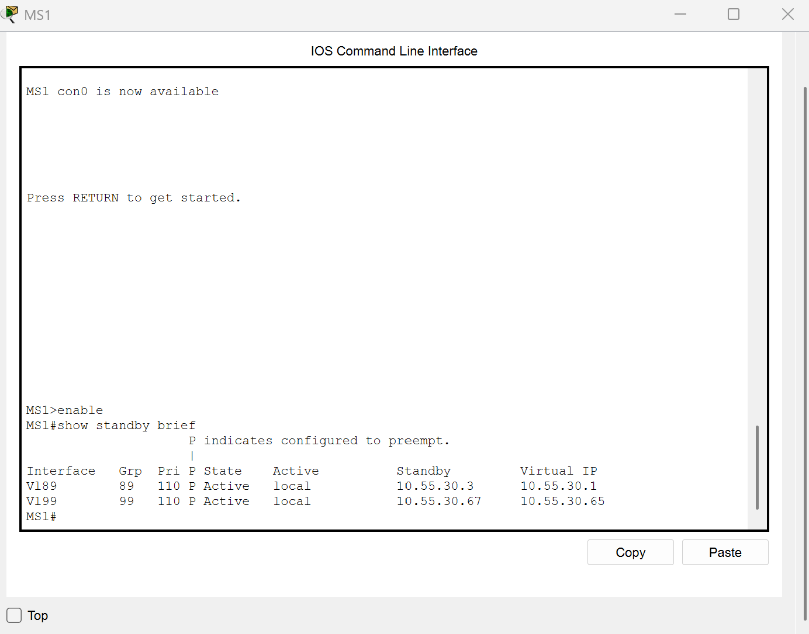
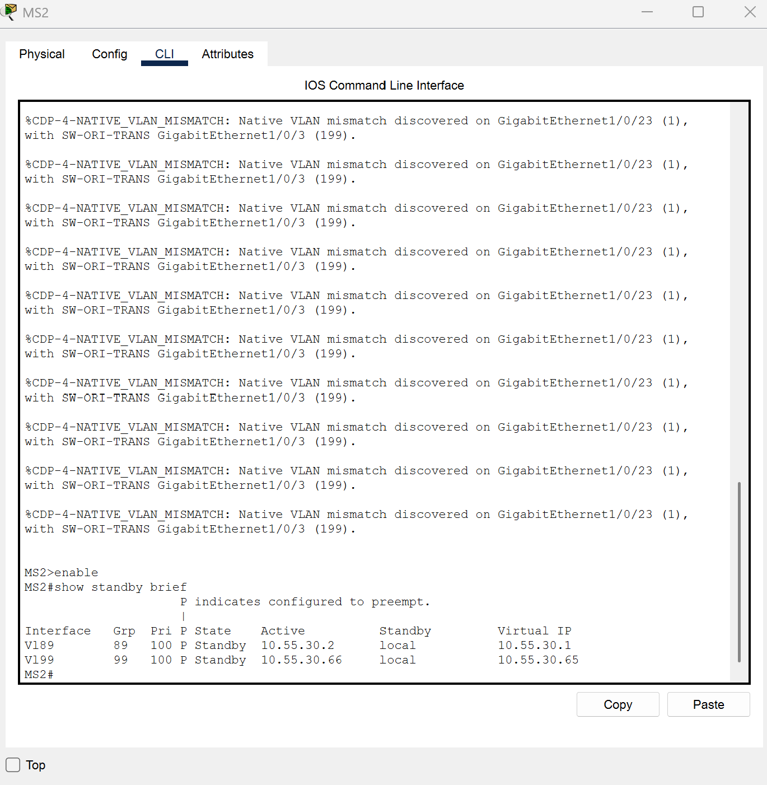

### 8.7. Prueba de conmutación ante fallos

Se simuló una interrupción del switch principal MS1.

La prueba permitió comprobar el cambio de rol de MS2 y la disponibilidad de los gateways virtuales de las VLANs 89 y 99.

Se verificó el acceso de los equipos finales a sus gateways y la recuperación de la comunicación después de la convergencia.

Al restaurar MS1, la configuración de prioridad y preempt permitió recuperar los roles originales.


**Justificación:** HSRP evita que las computadoras tengan que cambiar manualmente su puerta de enlace cuando deja de estar disponible el switch principal.

### 8.8. Integración RIPv2

MS1 y MS2 anuncian las redes de usuarios a R-ORIENTE a través de la red de tránsito `10.55.252.0/29`.

En R-ORIENTE se verificaron rutas RIP hacia:

- `10.55.30.64/26` — Plataforma.
- `10.55.30.0/26` — Bóveda.

Ambos switches multicapa actúan como posibles siguientes saltos para estas rutas.

**Comando de verificación:**

```cisco
show ip route rip
```

Las rutas de Oriente se integran con el Backbone Nacional mediante el proceso de redistribución del router de borde.

---

## 9. Data Center y Sede Central — Alta Seguridad

### 9.1. Descripción

El Data Center contiene los sistemas críticos del banco: servidores de bases de datos, servidores de aplicaciones web y equipos del Centro de Operaciones de Red (NOC).

Su infraestructura utiliza switches de distribución y acceso, Router-on-a-Stick para las VLANs y enrutamiento estático hacia la conexión nacional.

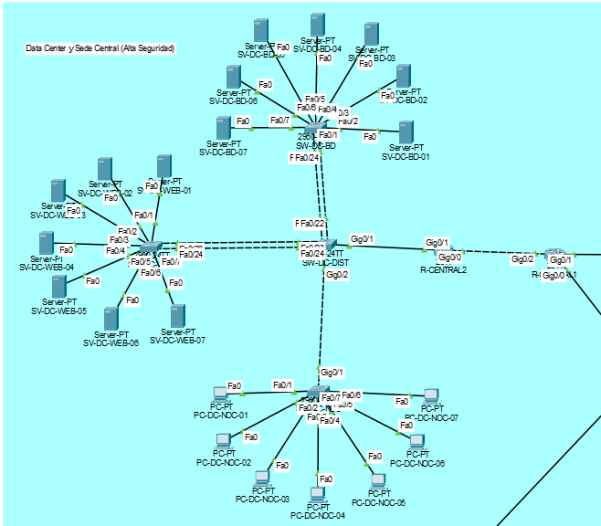

### 9.2. Justificación técnica

Se eligió una arquitectura jerárquica para organizar las granjas de servidores y centralizar sus enlaces en SW-DC-DIST.

Los enlaces hacia CORE_BD y WEB_APPS utilizan EtherChannel con LACP para agrupar dos conexiones físicas por granja.

Este diseño mejora la capacidad agregada y permite mantener comunicación cuando falla uno de los cables de un grupo EtherChannel.

R-CENTRAL2 funciona como router de acceso para las VLANs internas, mientras R-CENTRAL1 conecta el segmento estático con el Backbone Nacional.

La utilización de rutas estáticas permite mantener control explícito sobre el direccionamiento del Data Center.

### 9.3. Infraestructura

| Dispositivo | Modelo | Función |
|---|---|---|
| R-CENTRAL1 | Cisco 2911 | Redistribución de rutas |
| R-CENTRAL2 | Cisco 2911 | Router-on-a-Stick |
| SW-DC-DIST | Cisco 2960-24TT | Distribución |
| SW-DC-BD | Cisco 2960-24TT | Servidores CORE_BD |
| SW-DC-WEB | Cisco 2960-24TT | Servidores WEB_APPS |
| SW-DC-NOC | Cisco 2960-24TT | Equipos NOC |

### 9.4. VLANs del Data Center

| VLAN | Área | Subred | Gateway |
|---|---|---|---|
| 20 | CORE_BD | `10.55.40.32/28` | `10.55.40.33` |
| 30 | WEB_APPS | `10.55.40.0/27` | `10.55.40.1` |
| 40 | NOC | `10.55.40.48/28` | `10.55.49.65` |

### 9.5. EtherChannel LACP

| Grupo | Conexión | Puertos de SW-DC-DIST |
|---|---|---|
| Po1 | SW-DC-DIST ↔ SW-DC-BD | Fa0/21–22 |
| Po2 | SW-DC-DIST ↔ SW-DC-WEB | Fa0/23–24 |
| Po3 | SW-DC-DIST ↔ SW-DC-NOC | Fa0/19–20 |


**Configuración representativa en SW-DC-DIST:**

```cisco
interface range FastEthernet0/21 - 22
 channel-group 1 mode active

interface range FastEthernet0/23 - 24
 channel-group 2 mode active

interface range FastEthernet0/19 - 20
 channel-group 3 mode active
```

**Comando de verificación:**

```cisco
show etherchannel summary
```

Se comprobó que Po1, Po2 y Po3 aparecieran en estado `SU` con sus miembros físicos agrupados `(P)`.

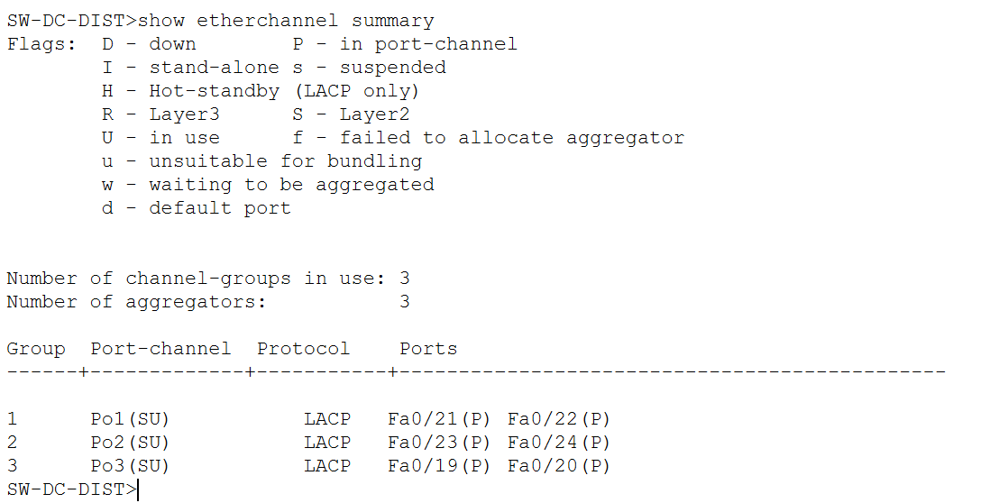

### 9.6. Router-on-a-Stick

**Dispositivo: R-CENTRAL2**

```cisco
interface GigabitEthernet0/1.20
 encapsulation dot1Q 20
 ip address 10.55.40.33 255.255.255.240

interface GigabitEthernet0/1.30
 encapsulation dot1Q 30
 ip address 10.55.40.1 255.255.255.224

interface GigabitEthernet0/1.40
 encapsulation dot1Q 40
 ip address 10.55.40.48 255.255.255.240
```

### 9.7. Rutas estáticas

**Dispositivo: R-CENTRAL1**

El enlace hacia R-CENTRAL2 utiliza la red `10.55.251.0/30`.

R-CENTRAL1 tiene la dirección `10.55.251.1` y R-CENTRAL2 utiliza `10.55.251.2`.

Las rutas estáticas principales de R-CENTRAL1 son:

```cisco
ip route 10.55.40.0 255.255.255.224 10.55.251.2
ip route 10.55.40.32 255.255.255.240 10.55.251.2
ip route 10.55.40.48 255.255.255.240 10.55.251.2
```

Estas rutas permiten llegar a las tres VLANs del Data Center.

R-CENTRAL1 utiliza OSPF para publicar las redes del segmento estático hacia el backbone.

### 9.8. Pruebas de redundancia

Se realizaron pruebas apagando temporalmente un enlace físico de Po1, Po2 y otro de Po3, por separado.

Se comprobó que los EtherChannels permanecieran operativos con el segundo miembro disponible y que los servidores continuaran comunicándose con sus gateways y con otras VLANs.

Posteriormente se restauraron ambos enlaces y se verificó el retorno de los dos miembros a estado `(P)`.

---

## 10. Pruebas integrales de conectividad nacional

### 10.1. Objetivo

Comprobar que todos los dominios de enrutamiento pueden intercambiar tráfico a través del Backbone Nacional.

Para ello se seleccionó un dispositivo representativo de cada sede.

| Sede | Dispositivo | IP |
|---|---|---|
| Occidente | PC-OCC-CAJ-01 | `10.55.10.2` |
| Norte | PC-NOR-ANAL-01 | `10.55.20.2` |
| Oriente | PC-ORI-BOV-01 | `10.55.30.4` |
| Central | SV-DC-BD-01 | `10.55.40.34` |

### 10.2. Matriz de conectividad

Los resultados obtenidos fueron:

| Origen / Destino | Occidente | Norte | Oriente | Central |
|---|---|---|---|---|
| Occidente | — | 4/4 | 4/4 | 4/4 |
| Norte | 4/4 | — | 4/4 | 4/4 |
| Oriente | 4/4 | 4/4 | — | 4/4 |
| Central | 4/4 | 4/4 | 4/4 | — |

**Resultado general: 12 de 12 comunicaciones dirigidas exitosas.**

En las pruebas finales se recibieron 48 de 48 paquetes ICMP, obteniendo un 100 % de éxito para los destinos seleccionados.

### 10.3. Evidencia desde Norte

Desde PC-NOR-ANAL-01 se ejecutaron:

```text
ping 10.55.10.2
ping 10.55.30.4
ping 10.55.40.34
```

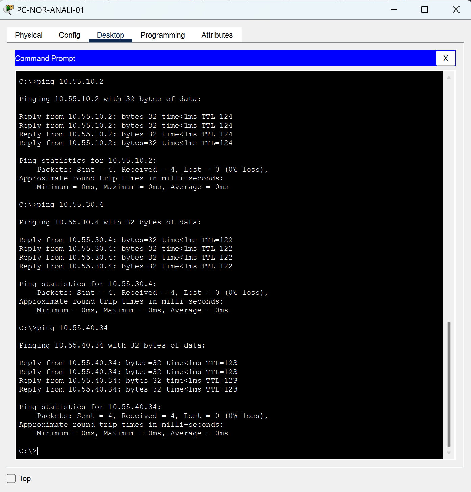

### 10.4. Evidencia desde Oriente

Desde PC-ORI-BOV-01 se ejecutaron:

```text
ping 10.55.10.2
ping 10.55.20.2
ping 10.55.40.34
```

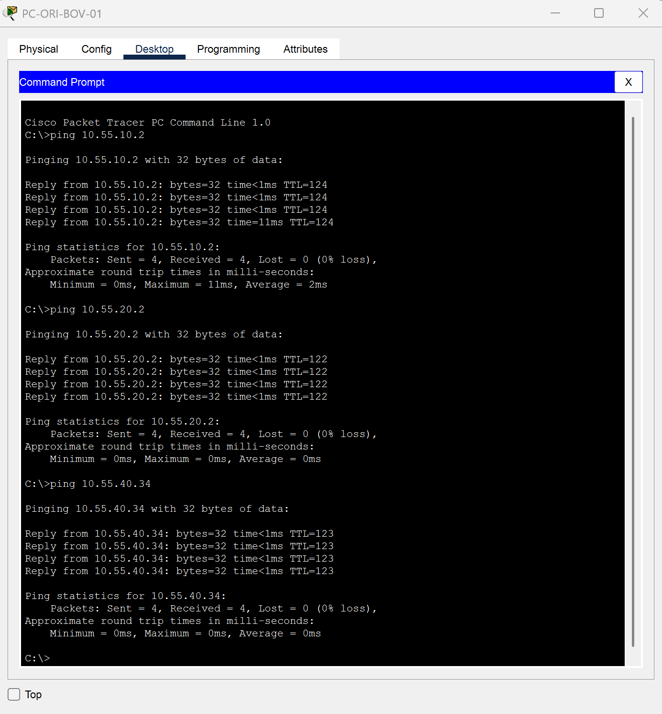

Las pruebas desde Occidente y Central también se realizaron con éxito, completando la matriz de comunicación nacional.

### 10.5. Interpretación de resultados

Las pruebas de conectividad permiten concluir que:

- Las redes de Occidente son alcanzables mediante el dominio OSPF.
- Las redes de Norte se integraron correctamente mediante EIGRP.
- Las redes de Oriente pueden comunicarse mediante RIPv2 y su integración con el núcleo.
- Las redes estáticas del Data Center son alcanzables desde las otras sedes.
- Las puertas de enlace inter-VLAN permiten comunicar los departamentos.
- Los mecanismos de redundancia proporcionan rutas o enlaces alternativos ante los fallos probados.

Estos resultados corresponden a las pruebas realizadas en el entorno de Cisco Packet Tracer.

---

## 11. Resumen de pruebas de alta disponibilidad

| Componente | Falla simulada | Mecanismo de recuperación |
|---|---|---|
| Backbone | Interrupción de Po1 | Ruta alternativa OSPF mediante CORE3 |
| Occidente | Pérdida de enlace hacia CORE1 | Ruta alternativa mediante CORE2 |
| Norte | Caída de uplink hacia ACC1 | Reconvergencia Rapid PVST+ |
| Oriente | Caída de MS1 | Conmutación HSRP hacia MS2 |
| Data Center | Caída de un miembro Po1 | Segundo miembro LACP |
| Data Center | Caída de un miembro Po2 | Segundo miembro LACP |

Estas pruebas se realizaron de forma controlada y los enlaces fueron restaurados posteriormente.

La disponibilidad se verificó después de los procesos de convergencia. No se afirma que las transiciones sean completamente libres de pérdida de paquetes ni que todas las fallas posibles estén cubiertas.

---

## 12. Conclusiones

1. Se implementó una infraestructura de red multisede capaz de comunicar las cuatro regiones de BanTech GT utilizando tecnologías de enrutamiento Cisco.

2. La segmentación mediante VLANs permitió organizar las redes según las necesidades funcionales de cada sede y reducir los dominios de broadcast.

3. La redistribución de rutas hizo posible integrar los dominios OSPF, EIGRP, RIPv2 y el segmento de rutas estáticas del Data Center.

4. Las tecnologías EtherChannel, Rapid PVST+ y HSRP aportaron mecanismos de tolerancia a fallos adaptados a las necesidades de cada sede.

5. Las pruebas realizadas confirmaron conectividad entre las cuatro sedes, alcanzando 12 comunicaciones dirigidas exitosas de 12 evaluadas.

6. El desarrollo permitió aplicar conocimientos de direccionamiento IPv4, VLSM, enrutamiento, switching, redundancia y diagnóstico de fallas en una infraestructura empresarial simulada.

---

## 13. Archivos del proyecto

El repositorio contiene:

- `README.md`: manual técnico y documentación de arquitectura.
- `BanTech_GT_Grupo9_202202055_FINAL_TERMINADO.pkt`: topología funcional de Cisco Packet Tracer.
- `evidencias/`: capturas seleccionadas de arquitectura, configuraciones y pruebas.

### Instrucciones para abrir la simulación

1. Instalar y abrir Cisco Packet Tracer 8.2.2 o una versión compatible.
2. Descargar el archivo `.pkt` del repositorio.
3. Abrirlo desde Cisco Packet Tracer.
4. Esperar a que las interfaces y los protocolos converjan.
5. Seleccionar cualquiera de las PCs utilizadas en las pruebas nacionales.
6. Abrir Desktop → Command Prompt y ejecutar los pings documentados.
7. Verificar las rutas y protocolos utilizando los comandos Cisco descritos en este manual.

---

## 14. Referencias

- Cisco Networking Academy. https://www.netacad.com/
- Cisco. Documentación técnica y referencias de comandos Cisco IOS. https://www.cisco.com/
- Cisco Packet Tracer. Herramienta de simulación utilizada en el proyecto.
- Universidad de San Carlos de Guatemala. *Redes de Computadoras 1. Proyecto 2 — Segundo Semestre 2026*. Enunciado académico del proyecto.

---
